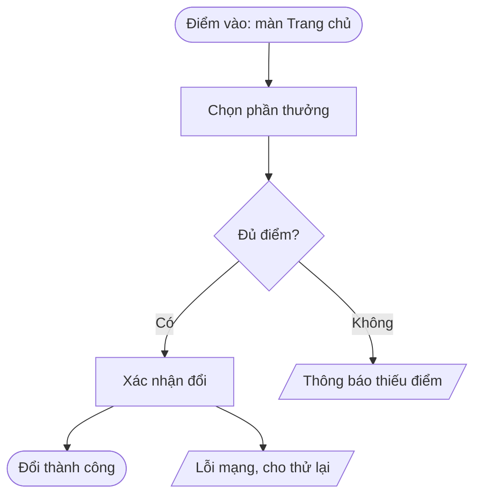

# Bước 3. User flow

Mục tiêu. Một sơ đồ mà PO, Designer và Dev đọc ra cùng một thứ.

## Trình tự

1. Đọc `research-brief.md` và `flow_rules` trong product profile.
2. Liệt kê các flow cần vẽ. Một user story lớn có thể tách nhiều flow.
3. Với mỗi flow, dựng file Mermaid `docs/sdlc/02-flow/<slug>.mmd`:
   - Node bắt đầu là điểm vào thật, ví dụ thông báo đẩy, deeplink, menu, không phải chữ Start chung chung.
   - Mọi node quyết định có đủ nhánh, không để nhánh treo.
   - Mọi flow có ít nhất một nhánh lỗi và một nhánh huỷ.
   - Ghi role được phép ở node cần phân quyền.
4. Kiểm bằng `node ${CLAUDE_PLUGIN_ROOT}/scripts/check-flow.mjs docs/sdlc/02-flow`.
5. Viết `docs/sdlc/02-flow/README.md` liệt kê các flow, điểm vào, điểm kết thúc.

## Quy ước Mermaid

Hình chữ nhật là màn hoặc thao tác. Hình thoi là quyết định. Hình bình hành là thông báo hoặc lỗi. Hình bo tròn là điểm vào hoặc kết thúc.

## Giới hạn

- Không nhảy sang wireframe khi flow chưa được duyệt.
- Không gộp nhiều tính năng vào một sơ đồ khổng lồ, tách theo mục tiêu người dùng.
